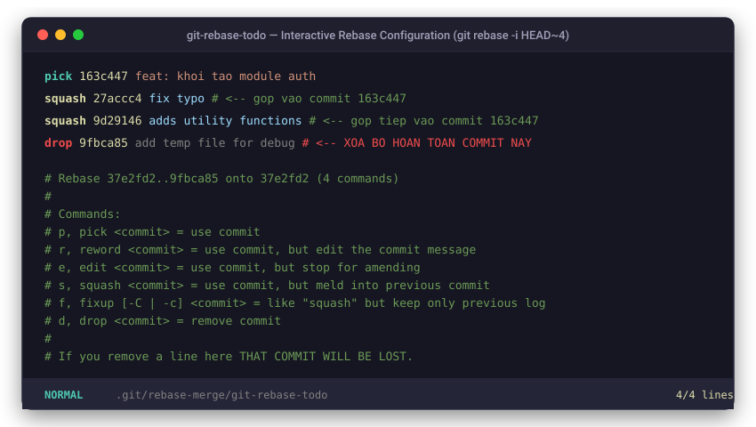
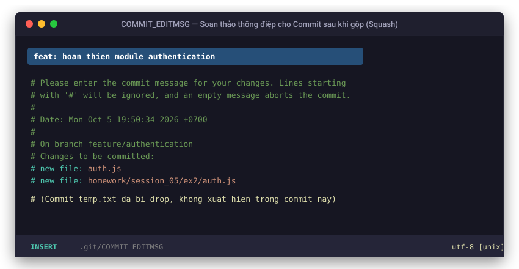
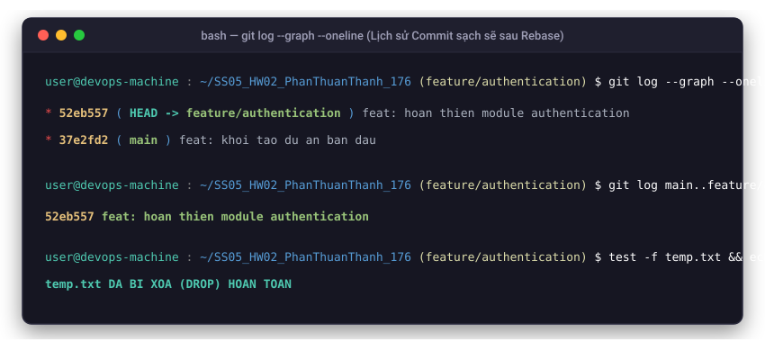

# BÁO CÁO BÀI TẬP 2: TÁI CẤU TRÚC LỊCH SỬ COMMIT BẰNG INTERACTIVE REBASE
---

## 1. Mục tiêu
- Sử dụng **Interactive Rebase** để làm sạch lịch sử commit cục bộ trước khi đẩy code lên remote repository.
- **Gộp commit (Squash):** Gộp 3 commit nhỏ lẻ thành 1 commit duy nhất đại diện cho tính năng hoàn chỉnh.
- **Đổi thông điệp (Reword):** Đổi thông điệp sau khi gộp thành: `feat: hoan thien module authentication`.
- **Loại bỏ commit rác (Drop):** Xóa bỏ hoàn toàn commit chứa tệp thử nghiệm `temp.txt`.

---

## 2. Các bước thực hiện

### Bước 1: Khởi tạo 4 commit thử nghiệm trên nhánh `feature/authentication`
```bash
git checkout -b feature/authentication

# Commit 1: Tạo auth.js
git add auth.js && git commit -m "feat: khoi tao module auth"

# Commit 2: Sửa auth.js
git add auth.js && git commit -m "fix typo"

# Commit 3: Bổ sung utility functions cho auth.js
git add auth.js && git commit -m "adds utility functions"

# Commit 4: Tạo file rác temp.txt
git add temp.txt && git commit -m "add temp file for debug"
```

Lịch sử 4 commit trước khi rebase (`git log --oneline`):
```text
9fbca85 (HEAD -> feature/authentication) add temp file for debug
9d29146 adds utility functions
27accc4 fix typo
163c447 feat: khoi tao module auth
37e2fd2 (main) feat: khoi tao du an ban dau
```

---

### Bước 2: Thực hiện Interactive Rebase (`git rebase -i HEAD~4`)
Chạy lệnh:
```bash
git rebase -i HEAD~4
```

#### 1. Cấu hình danh sách lệnh Rebase (`git-rebase-todo`):
Đổi `pick` thành `squash` (hoặc `s`) và `drop` (hoặc `d`) như sau:
```text
pick 163c447 feat: khoi tao module auth
squash 27accc4 fix typo
squash 9d29146 adds utility functions
drop 9fbca85 add temp file for debug
```



#### 2. Cập nhật thông điệp commit mới sau khi gộp:
Khi cửa sổ soạn thảo thông điệp hiện ra, đổi nội dung thành:
```text
feat: hoan thien module authentication
```



---

## 3. Kiểm tra kết quả

### 3.1. Lịch sử commit sạch sẽ sau khi Rebase
Chạy lệnh kiểm tra:
```bash
git log --graph --oneline
```
**Kết quả:**
```text
* 26e5bb8 (HEAD -> main, feature/authentication) feat: hoan thien module authentication
* 37e2fd2 feat: khoi tao du an ban dau
```



> Toàn bộ commit vụn vặt và commit rác đã được xử lý, chỉ còn **1 commit duy nhất** đại diện cho tính năng authentication.

### 3.2. Xác nhận tệp `temp.txt` đã bị xóa hoàn toàn (Drop)
```powershell
Test-Path temp.txt
# Kết quả: False (tệp rác đã bị xóa hoàn toàn khỏi cây Git và ổ đĩa)
```

---

## 4. Hướng dẫn chạy và kiểm thử chương trình

Chương trình có sẵn kịch bản kiểm thử tự động tại `test.js` (tuân thủ quy chuẩn không chứa comment):

```bash
# Chạy kiểm thử:
node test.js
```

**Kết quả kiểm thử thực tế từ Terminal:**
```text
=== BAT DAU KIEM TRA MODULE AUTHENTICATION ===

[TEST 1] Kiem tra ham hashPassword: SHA-256 Hash nhat quan: true
[TEST 2] Kiem tra ham register: Dang ky va chan trung lap thanh cong
[TEST 3] Kiem tra ham login voi thong tin chinh xac: Cap token thanh cong
[TEST 4] Kiem tra ham login voi sai mat khau: Tra ve null an toan
[TEST 5] Kiem tra ham validateToken: Token hop le
[TEST 6] Kiem tra ham logout: Thu hoi token thanh cong

=== TAT CA 6 TEST CASE DEU HOAN THANH XUAT SAC ===
```
